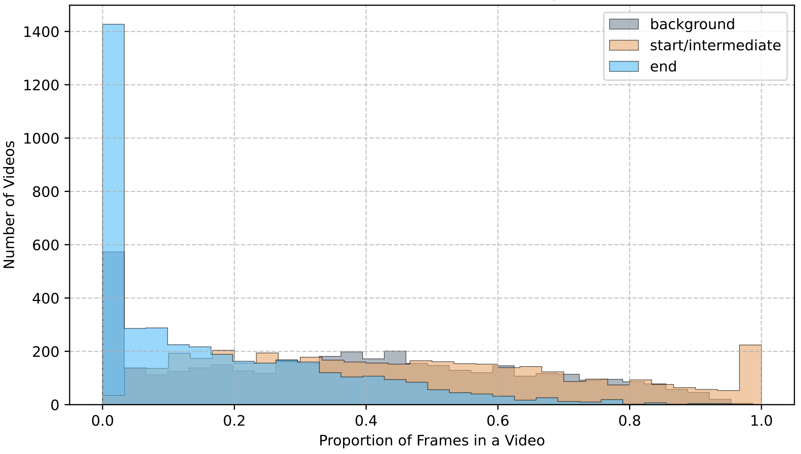
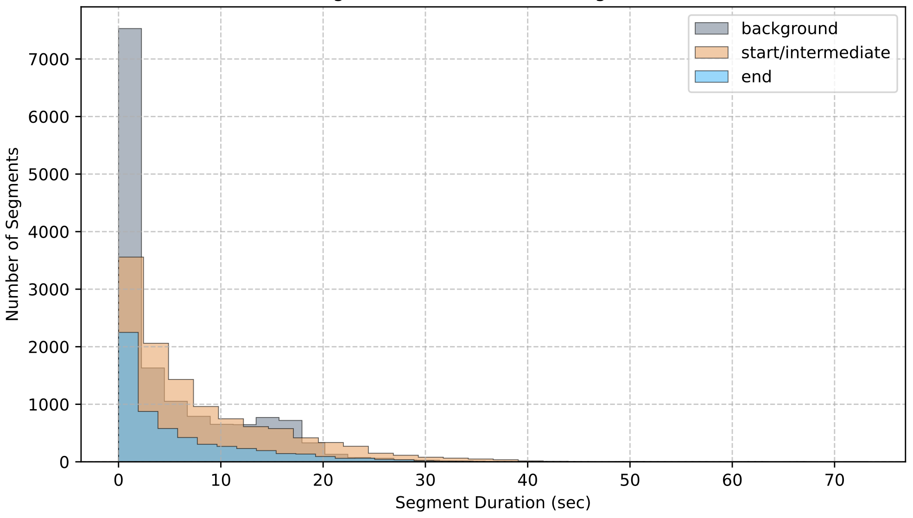

# Background and Related Works

<figure id="fig:1" data-latex-placement="!t">

<embed src="./figures/teaser_ostc-updated.pdf" /> 

<figcaption>Online Frame-wise Object State Change
Classification</figcaption>
</figure>

We first provide an overview of existing research in the area of
procedural state changes, along with other relevant works that inspire
our approach.

## Procedural Activity Understanding

Procedural activity refers to a temporally structured sequence of
goal-directed steps, often governed by causal dependencies and resulting
in observable state changes. Procedural activity understanding has been
extensively studied in computer vision literature, enabled in large part
by the widespread availability of web-scale instructional videos. A
first line of work focuses on learning joint text--video representations
from narrated instructional videos
[@TAN; @MIL-NCE; @HowTo100M; @another_representation_learning] a range
of downstream tasks, including text-to-video retrieval, key-step
recognition, and step forecasting.

Outside the realm of comprehension and modeling of procedural
activities, many works target procedural generation and planning for
assistance by generating subsequent action sequences or visual
demonstrations of future steps [@VidAssist; @VLaMP; @ShowHowTo].
However, these methods generally assume that the user explicitly
provides a video at the moment they wish to receive help, placing the
burden of deciding when assistance is needed entirely on the user, which
limits its effectiveness for truly assistive AI scenarios that require
autonomous judgment about when guidance should be delivered.

## Object State Changes

Object State Changes (OSC) captures the transformation of an object from
one state to another, and is crucial for procedural understanding from
visual signals. Several recent works have targeted the temporal
localization of the start, transition, and end states of OSCs through
semi-supervised or self-supervised learning approaches
[@vidOSC; @ChangeIt]. In addition to temporal reasoning, spatial
localization of object state changes has also been explored, enabling
models to attend to specific regions undergoing transformation [@SPOC].

Understanding object state changes has been shown to facilitate
procedural activity understanding. For example, SCHEMA [@SCHEMA]
demonstrates that incorporating state change as a core reasoning
primitive for goal-oriented procedural planning leads to improvements
over state-of-the-art baselines. Similarly, by capturing contrasts
between the current state and before, after, and counterfactual states
for procedural-aware video representation learning, a novel approach
yields enhanced performance on several downstream tasks, including
temporal action segmentation and error detection [@egoVIS].

## Online Keystep Recognition and Progress Estimation

Most prior works on procedural activity understanding and object state
change (OSC) modeling have predominantly operated in offline settings,
where the entire video is available beforehand. However, performing
procedural activity understanding in an online or streaming manner is
critical for real-world applications such as real-time AR/VR assistance,
robotics, and human-computer interaction. Despite its practical
importance, this area remains relatively underexplored [@ProVideLLM].
Existing approaches designed for offline video understanding often
struggle when applied directly to streaming scenarios as they either
suffer from significant computational complexity when applied to
streaming frames or incomplete temporal
context[@progress_aware; @ProVideLLM].

Recent efforts in streaming video understanding have increasingly
focused on online action detection and segmentation tasks. MiniROAD
[@MiniROAD] introduced an efficient RNN-based framework for online
action detection, while ProVideLLM [@ProVideLLM] proposed a sliding
window approach augmented with periodic summarization via large language
models (LLMs). Both works address the challenge of retaining memory
efficiently for real-time action recognition. Other studies have
explored the notion of task progress. For instance, ProTAS
[@progress_aware] presented a method for refining keystep segmentation
by estimating the progress within the current step, while
[@activity_progress] investigates online progress estimation for
higher-level activities.

## Recurrent Network

Our model is motivated by prior research on online action segmentation
and detection. [@progress_aware] proposes an online action segmentation
framework for egocentric procedural videos. A causal architecture that
processes frames online and maintains a hidden state representation that
summarizes all past frames is included. It used temporal convolution
layers with an online approach to integrate visual evidence.
[@becattini2020done] is one of the early works that introduced action
prediction and used a combination of per-frame detectors and LSTM to
aggregate over time. It demonstrates the importance of recurrent memory
and progress regression for understanding the state of an action.
[@zhou2018towards] proposes the task of procedure segmentation of long
instructional videos, and introduces a segment-level recurrent network
to model temporal dependencies between segments. [@li2016online] defines
the online action detection task on a streaming skeleton data, and
utilizes an LSTM to jointly classify actions and regress over temporal
positions. It demonstrates the effectiveness of the recurrent models for
online and frame-by-frame detection, and initial/end localization.
[@eun2020learning] showcases a novel recurrent unit, called the
information discriminating network to distinguish between relevant
information and background for effectively learning an online action
detection task. It's experimental results compare different types of
recurrent networks such as simple RNN, LSTM, and GRU, and shows that GRU
achieves the highest performance for online action detection on the
TVSeries dataset. [@an2023miniroad] proposes a simple GRU architecture
for online action detection and argues that with the right training
methodology, GRU can learn temporal reasoning and achieve higher
accuracy in online action detection as compared to models having
attention layers, such as vision transformers.

## Loss Function

We utilize a novel loss function motivated from papers targeting online
learning-based tasks. For instance, [@gao2021woad] focused on
frame-by-frame action detection, and used a frame-wise cross-entropy
loss function for supervised learning. [@ma2016learning] focused on the
task of activity progression and introduced loss functions to encourage
models to learn monotone behavior. It specialized monotonicity for an
object state; we took inspiration to utilize a pairwise monotone
constraint on the end-state probability over time within a chosen
context window. [@yeche2023temporal] focused on the task of early
prediction of critical events within an online context and constructs a
time-dependent monotone target curve instead of hard binary labels.
[@grandvalet2004semi] introduces a minimum entropy regularizer to
encourage confident predictions. We motivate obtaining sharpened state
predictions from this research.

# Technical Approach

## Problem Statement

Consider a dataset $D = {(O_i, V_i, Y_i)}$, $i = 1$ to N. Each example
in $D$ consists of $O_i$, an LLM-enhanced object state description in
text form, $V_{i}$ the sequence of RGB video frames, and $Y_i$, the
sequence of state labels corresponding to each frame, where
$y_{i,t} \epsilon$ 0 = background, 1 = initial/transitioning, 2 =
ending. The goal is to learn a model that recognizes the object's state
at each frame of a given video using visual history and the semantic
content of the OSC. More formally, for each timestamp $t$, the model
receives the current RGB frame $V_{i,t}$, an embedded representation of
the LLM-enhanced OSC, and a hidden state $h_{t-1}$ representing a
summary of frames $V_{i-1,t}$ to $V_{1,t}$. Hence, we can think of the
model as a learned function $F: (V_{i,t}, e_O, h_{t-1})$ → $(y_t, h_t)$,
where $y_t \epsilon R^3$ and $h_t$ is the updated hidden state
incorporating frame $V_{i,t}$.

## Dataset

### Forming a Frame-Wise OSC Dataset

In order to learn this online OSC classification, we need to collect
procedural videos with precise temporal annotations of where object
state changes are occurring. While the original HowToChange evaluation
benchmark provides detailed temporal annotations, the annotations are
provided at the segment-level. The temporal annotations are only in the
form of initial state intervals, transitioning state intervals, and
end-state intervals. Our model requires frame-wise supervision since the
model needs to learn the exact frame boundaries between object states,
so the temporal annotations in HowToChange are not fine-grained enough
for our goal.

To modify HowToChange for frame-wise supervision, we create a train and
test split of the HowToChange evaluation dataset and convert the
temporal interval annotations into frame-wise labels for a
fully-supervised state labeling approach. For each clip, we extract
frames at the clip's frame rate and assign each frame to one of three
labels: 0 for background state, 1 for initial or transition state, and 2
for ending state. If the frame falls in an end-state temporal interval,
the frame is labeled with 2. If the frame falls in either an initial
state or transitioning state, the frame is labeled with 1. Additionally,
frames that don't fall in any of these interval types are labeled with
0. This produces an aligned triplet $(O, V, Y)$ consisting of the state
description, the video frame sequence, and the corresponding per-frame
label sequence.

<figure id="fig:Distribution of State Frames Across Training Videos"
data-latex-placement="h">

<figcaption>Distribution of State Frames Across Training
Videos</figcaption>
</figure>

### Forming a Description Bank for Object State Descriptions

In the original HowToChange evaluation benchmark, the only textual
information for each video is the OSC, provided in the form
\"verb_noun\", e.g. \"rolling_pasta\". However, this textual context is
high-level and offers no details about what the task entails or how a
user would progress through it. In its given form, it is insufficient
for direct use in our model, which relies on an accurate and robust
per-frame textual-visual alignment.

For each of the 409 OSCs in the evaluation benchmark, we use OpenAI's
gpt-5-nano model to generate LLM descriptions for the initial,
transition, and end states of the task. As an example, below is the
prompt to and response from the LLM for the transition state of
\"zesting_orange\":\

::: minipage
`Prompt: Suppose you are a professional video dataset annotator and have been asked to succinctly describe in under 80 words while still being precise and informative: the intermediate states of zesting orange (including but not limited to attributes like shape, size, color, consistency, etc.). What does it look like after zesting orange has started and is currently in progress? For the person engaging in zesting orange, what might they be doing? Do not mention anything about the start or end states of zesting orange.`

`Response: Intermediate zesting state shows uneven ribbons and irregular shreds of bright orange rind accumulating around the tool. Thin, flexible strips curl as citrus oils sheen their surfaces; tiny shavings disperse in a fine dust along the cutting edge. The exposed zest is mostly orange, with a pale, fibrous rind near the white pith. The person alternates grip and pressure, guiding a peeler or zester across the fruit, rotating to access fresh patches, scraping lightly to avoid pith.`\
:::

Before training and inference, we create this LLM description bank
specific to the HowToChange OSCs. Although this pre-processing is not
generalizable to new datasets, our intention is to demonstrate the merit
of using LLM-generated descriptions for identifying state transitions in
online videos. For extensibility, our future implementation would
involve an online LLM workflow, where each unseen OSC is fed into an LLM
pipeline during inference to obtain descriptions of its temporal states.

## Dataset Statistics

Our curated frame-wise HowToChange dataset is split into a training set,
which contains 4071 procedural videos, and a testing set, which contains
712 videos. For each OSC, approximately 15% of videos were randomly
sampled into the test split. OSCs with three or fewer total video
samples were excluded from the test split and included only in the train
split. This was done to ensure sufficient training coverage, given the
limited scale of available data. We analyzed our frame-wise labeling
approach to identify each video's state segments, which we define as
contiguous frame sequences labeled with the same state.

After running our labeling approach on all of our videos, our training
set contains a total of 14483 background segments, 11514 initial or
transitioning segments, and 5757 end segments. Furthermore, because of
the sparsity end segments, we investigated the proportion of end state
frame labels for each video. Figure 2 shows that the majority of videos
in our training set contain less than 5% of end state frames.
Additionally, we compared the end state frame proportions of each video
to the initial/transitioning frame proportion and background frame
proportion of each video. Figure 2 shows that the spread of proportions
of initial/transitioning state frames and background state frames are
relatively even and dominate in comparison to the spread of end state
frame proportions. This reveals that our learned model needs to overcome
a severe class imbalance in order to properly predict end state frames.

<figure id="fig:Segment Durations in Training Videos"
data-latex-placement="h">

<figcaption>Segment Durations in Training Videos</figcaption>
</figure>

In addition to analyzing the class imbalance inherent in our frame-wise
labeling approach, we also analyze the state segments from the videos in
our training set for duration. Figure 3 shows the majority of state
segments for all three states are less than 10 seconds long, including
7000 segments that are less than 2 seconds long. This implies that our
model also needs to be capable of fine-grained understanding of object
states in order to identify these extremely small state segments.

# Training

## Architecture

<figure id="fig:1" data-latex-placement="!t">

<embed src="./figures/ostc_diagram.pdf" /> 

<figcaption>The overall Recurrent network architecture</figcaption>
</figure>

Our proposed model utilizes a trainable recurrent-style architecture
with a frozen LongCLIP [@zhang2024longclipunlockinglongtextcapability]
backbone. The overall model's input is the streaming video of the object
state change and it's corresponding generated text description, whereas,
the output is the discrete frame-wise state classification of the
background, initial/transition, and end states. If $\mathcal{X}$ and
$\mathcal{Y}$ represent the space of input image and text tokens,
$\text{LongCLIP}_{\text{image}}: \mathcal{X} \rightarrow \mathbb{R}^d$
and
$\text{LongCLIP}_{\text{text}}: \mathcal{Y} \rightarrow \mathbb{R}^d$
represents the LongCLIP text and image backbones respectively. Hence,
$$\begin{align}
q^{\text{img}}_t &= \text{LongCLIP}_{\text{image}}(X_t) \in \mathbb{R}^d\\
q^{\text{text}} &= \text{LongCLIP}_{\text{text}} (Y) \in \mathbb{R}^d\\
z_t &= q^{\text{img}}_t \oplus q^{\text{text}} \in \mathbb{R}^{2d}
\end{align}$$ where, $X_t \in \mathcal{X}$ are the input video frames,
$Y$ is the text input from the description bank, and $z_t$ is the shared
representation. We note that these frozen layers share a common
embedding space. The shared representation combines the vision
information for the given frame and it's corresponding text
descriptions. Our multi-modal fusion layer takes these shared
representations and passes them through a fully-connected feed-forward
network containing Linear, RELU, and Dropout layers, i.e.,
$$\begin{align}
  f_t = \mathrm{Dropout}\big(\mathrm{ReLU}(W_f z_t + b_f)\big)
  \in \mathbb{R}^{H}
\end{align}$$ where, $W_f, b_f$ are feed-forward weights, and $f_t$ is
the output of the fusion layer. The hidden states of the Gated Recurrent
Unit (GRU) network [@chung2014empirical] are of size $\mathbb{R}^H$. We
observe that the fusion layer learns the task-specific projection from
the shared representation space to a lower-dimensional space. Our
approach requires utilizing temporal and causal context from previous
frames. This is essential for a progressive understanding of the object
state changes in a streaming scenario. GRU uses a hidden state to encode
the memory of past observations as a compressed latent space. This is
the key reason we employed
$\text{GRU}: \mathbb{R}^H \times \mathbb{R}^H \rightarrow \mathbb{R}^H$
in our architecture. Let $f_t, h_t$ represent the output of the fusion
layer and the hidden state respectively at time step $t$, we have:
$$\begin{equation}
h_{t} = \mathrm{GRU}(f_t, h_{t-1})
\end{equation}$$ where, the $\text{GRU}$ network can be expanded as:
$$\begin{align}
  z_t &= \sigma(W_z f_t + U_z h_{t-1} + b_z) \\
  r_t &= \sigma(W_r f_t + U_r h_{t-1} + b_r) \\
  \tilde{h}_t &= \tanh\!\big(W_h f_t + U_h (r_t \odot h_{t-1}) + b_h\big) \\
  h_t &= (1 - z_t) \odot h_{t-1} + z_t \odot \tilde{h}_t
\end{align}$$ where, $U_z, U_r, W_z, W_r$ are the weight matrices,
$b_z, b_r$ are the biases, $\sigma$ is the sigmoid function, and $\odot$
is the element-wise multiplication. Finally, the linear classifier uses
the hidden state to make a frame-wise prediction of the current state:
$$\begin{align}
\begin{bmatrix} 
\hat{y}_{t,0}\\
\hat{y}_{t,1}\\
\hat{y}_{t,2}
\end{bmatrix} = \hat{y}_t &= W_y h_t + b_y
\end{align}$$ Here, $\hat{y}_t \in \mathbb{R}^3$ is the model's output
logits used for prediction.

## Loss function

For our loss function, we combined the weighted entropy loss, entropy
regularization, and monotonicity loss terms. The weighted cross entropy
loss is essential to train the recurrent network corresponding to our
specific task of determining where the background, initial/transition,
or, end-states are the most probable. The usual cross-entropy loss does
not take into account the class imbalance described in the previous
sections; the class weights are necessary to rebalance the optimization
terrain and capture the critical state-change regions. Let $w_c$ denote
the class weights for class $c \in \{0,1,2 \}$. The weighted cross
entropy loss per frame is: $$\begin{align}
l_{\text{CE}} (\hat{y}_t, y_t)= -w_{y_t} \ \hat{y}_{t, y_t} + w_{y_t} \log (\sum_{i=0}^{2} \exp(\hat{y}_{t,i}))
\end{align}$$ For the entire video, the weighted cross-entropy loss is:
$$\begin{align}
\mathcal{L}_{CE} = \frac{1}{T} \sum_{t=1}^T l_{\text{CE}} (\hat{y}_t, y_t)
\end{align}$$ where, $T$ is the total number of frames in the video. The
discrete probability distribution from the output logits is stated as:
$$\begin{align}
p_t = \begin{pmatrix} 
p_{t,0}\\
p_{t,1}\\
p_{t,2}
\end{pmatrix}
\end{align}$$ where, $$\begin{align}
p_{t,c} = \frac{\exp(\hat{y}_{t,c})}{\sum_{c=0}^2 \exp(\hat{y}_{t,c})}
\end{align}$$ This distribution over the logits is utilized for
computing the Entropy terms. Entropy regularization measures the model's
confidence to predict the decisive moments during state changes. The
procedural activities for which we aim to detect transitions have
decisive moments that last short periods of time. Hence, it becomes
vital to train the model to be unambiguous in deciding when those
moments occur. Merely utilizing the cross entropy loss may lead to
spreading the probability mass of the logits over a wide temporal band,
especially when features are noisy, which hinders our objective of
online, on-time detection. Applying an entropy regularization yields a
sharp transition region, and allowing the model to commit to confident
and consistent end-state predictions. The Entropy per frame is given by:
$$\begin{align}
H(p_t) = - \sum_{c=0}^2 p_{t,c} \log p_{t,c}
\end{align}$$ The Entropy Loss for the complete video is:
$$\begin{align}
\mathcal{L}_{E} = \frac{1}{T} \sum_{t=1}^T H(p_t)
\end{align}$$ We capture the temporal order and nature of the labels
using the monotonicity loss. A significant portion of the transitions
are irreversible. For instance, a sliced tomato can't be unsliced. The
monotonicity loss establishes a strong prior that the latent notion of
progress toward the end state is always in the forward direction. Hence,
prediction progress in the opposite direction (from the end state to
initial/transition or background) is penalized. Additionally,
monotonicity is helpful to implicitly align the GRU to understand the
temporal consistency of state changes. The monotonicity loss is:
$$\begin{equation}
\mathcal{L}_{M} = \frac{1}{k-1} \sum_{t=1}^{T-1} \max (0,p_{t,2} - p_{t+1, 2})
\end{equation}$$ where, $k$ is the context length. Hence, our overall
loss function is: $$\begin{equation}
\mathcal{L} = \mathcal{L}_{CE} + \lambda_E \mathcal{L}_{E} + \lambda_M\mathcal{L}_M
\end{equation}$$ where, $\lambda_E, \lambda_M$ are the relevant
hyper-parameters for appropriately weighing the entropy and monotonicity
loss terms.

# Evaluation

## Experimental Setup

### Testbed

We evaluate our model on one NVIDIA G200 (480 GB) GPU running CUDA 12.8.

### Implementation

We empirically found the following model implementation and training
values to work well:

Our 1-layer fusion component has a hidden dimension of 256, ReLU
activation, and dropout of 0.1. The GRU layer and 1-layer classifier
also use hidden dimensions of 256.

For our hyperparameters, we chose $\lambda_E=0.1$, $\lambda_M=0.1$,
$lr=0.001$. We sample videos at 1 FPS. Results shown are the result of
training over 1 epoch of 4071 videos, which took roughly 5 hours to
train.

### Baseline

We used vidOSC [@vidOSC] as our baseline. vidOSC provides two types of
models for offline OSC segmentation: the single task model family, where
the action is known beforehand and each model specializes in only one
action, and the multitask model that generalizes to all actions that
appear in the HowToChange dataset.

### Metrics

For evaluation on state detection between background, in progress, and
end state, we measured the accuracy, F1 score, and precision. The F1
score and precision are averaged across the three classes, then averaged
across all videos. We used end state F1 score and end state interval IoU
scores for evaluation on end state detection. We also measured inference
time as latency is critical for real time applications.

## Quantitative Results

::: table*
  Method                            Acc (%) $\uparrow$   F1 (%) $\uparrow$   Prec (%) $\uparrow$   End State F1 (%) $\uparrow$   End State IoU (%) $\uparrow$
  -------------------------------- -------------------- ------------------- --------------------- ----------------------------- ------------------------------
  VidOSC (Multitask) [@vidOSC]            38.07                17.21                13.52                     1.37                           1.64
  VidOSC (Single task) [@vidOSC]        **53.15**              34.23                35.72                     31.51                         36.91
  Ours                                    49.50                31.91                31.25                     31.25                         36.92
  Ours (+ LLM description)                51.54              **41.80**            **49.66**                 **34.73**                     **41.36**
:::

### All State Detection Results

Table [\[tab:1\]](#tab:1){reference-type="ref" reference="tab:1"}
presents the performance of our proposed method compared to prior
approaches on general state detection metrics, namely Accuracy, F1
Score, and Precision. Our online method demonstrate comparable
performance on state detection to our offline baselines. VidOSC's single
task models [@vidOSC] achieves the highest accuracy (53.15%) when
trained in a single-task configuration. Our method achieves a comparable
accuracy of 51.54% when enhanced with LLM-based descriptions, and
outperforms both versions of VidOSC in F1 Score and Precision, reaching
41.80% and 49.66%, respectively.

### End State Detection Results

Our approach also shows strong performance on end state metrics,
specifically End State F1 and End State IoU, as shown in the last two
columns of Table [\[tab:1\]](#tab:1){reference-type="ref"
reference="tab:1"}. Our model achieves 34.73% End State F1 and 41.36%
End State IoU, surpassing VidOSC's single task baseline by a notable
margin. These results suggest that our method is particularly effective
at identifying the end state of OSCs, aligning with the model's intended
design.

### Descriptions Bank

While our baseline model without LLM-generated descriptions bank already
achieves strong performance across all metrics, the addition of LLM
descriptions leads to consistent improvements, most notably a 9.89%
absolute gain in F1 Score and a substantial boost in Precision and End
State IoU. These results indicate the effectiveness of supplementing the
model with external knowledge through explicit text descriptions of the
expected visual states.

### Latency

We measured our model's inference time per frame over the entire test
set, averaging around 0.13s on GH200 including the latency of extracting
features from state descriptions bank with LongCLIP. Those features
could be pre-extracted since the descriptions bank is prepared forehand
and we will expect the latency to significantly reduce with
pre-extracted text features.

## Qualitative Results

<figure id="fig:1" data-latex-placement="!t">

<embed src="./figures/success_failure_ostc.pdf" /> 

<figcaption>Illustration of a success (slicing lemon) and failure case
(grilling onion) for our model. Red bars indicate background state, blue
bars indicate initial/in-progress state, and green bars indicate end
state. The lower row of bars correspond to predicted states, and the
upper row corresponds to the ground truth states. The success case
illustrates that our model predicts the end state at the exactly right
point in the video. The failure case shows zero similarity between the
predicted and ground truth states, and the model never identifies the
end state.</figcaption>
</figure>

We provide the
[visualizations](https://drive.google.com/drive/folders/1xKi9VBBudoOXCe8yglSkHi6zfuRMaGPt?usp=sharing)
of our best and worst detection results. All video samples are from the
test set and contain nonempty end state intervals. The captions show our
model's real-time detection at 1 FPS as well as the ground truth label.

::: {#tab:success}
  Acc.               IoU
  ------------------ --------------------
  rolling bread      grilling cheese
  chopping chicken   slicing lemon
  peeling prawn      melting mozzarella
  slicing cake       blending cheese
  blending almond    peeling mango

  : OSCs of Top-5 videos by Accuracy and End State IoU.
:::

::: {#tab:failure}
  Acc.                 IoU
  -------------------- -------------------
  chopping chocolate   grilling onion
  frying fish          grilling onion
  frying ginger        melting chocolate
  chopping spinach     roasting coconut
  frying shallot       browning pork

  : OSCs of Bottom-5 videos by Accuracy and End State IoU.
:::

### Analysis on Success Cases.

As shown in [2](#tab:failure){reference-type="ref"
reference="tab:failure"}, our model performs well on actions such as
\"peeling\" and \"slicing\". Overall, for those success samples, the
video usually has clear, unambiguous end state, either inherent from the
OSC or through editing. For example, the visual distinction between a
peeled mango and an unpeeled mango or between a sliced lemon and a whole
lemon is large, while the visual distinction is much more subtle between
slightly roasted coconut and fully roasted coconut. For other OSCs that
could be visually subtle, such as \"melting mozzarella\", the editing in
those particular videos tends to isolate and showcase the end state
well, making it easy for both the intended human audience and the model
to identify the end state.

### Analysis on Failure Cases

As shown in [2](#tab:failure){reference-type="ref"
reference="tab:failure"}, \"frying\", \"grilling\", \"chopping\" are the
most frequent OSCs among the worst-performing samples. Actions like
\"frying\", \"grilling\", \"roasting\" and \"browning\" present
particular challenges for state change detection as the margins between
in progress and finished states can be subtle and highly nuanced for
those actions. Even though our state descriptions bank should supplement
our model with knowledge about the expected visuals, it is difficult for
language to capture those subtleties explicitly. For instance, terms
like brown or golden-brown, commonly used to describe the final state of
frying, encompass a broad range of shades, making precise identification
difficult. Sometimes, the description might even model performance when
the actual end state visuals do not quite match the description.

Unlike offline models that can compare visual states across the entire
temporal context and infer the most probable states retrospectively,
online inference must make decisions without such clues. This limitation
introduces a fundamental ambiguity considering the fact that
\"finished\" state is a subjectively defined notion that could refer to
a range of object states. For instance, in the case of roasting, are we
expecting light, medium, or dark roast? Similarly, in chopping, is the
goal to produce large or finely diced pieces? While an offline model can
resolve such ambiguities by referencing the final state present in the
full video context, online models do not have such knowledge. This
challenge suggests a need for either more explicit action specification
during inference, or a potential reformation of the task: instead of
identifying finished states where the expectation for the finished state
is subjectively defined, identify the objective state, such as light,
medium, or dark roasting, or degrees of browning from slightly browned,
browned, to burnt.

# Future Work

We see several avenues for potential future work from this project, many
of which address the limited applicability and generalizability of our
approach.

Many procedural activity datasets, including HowToChange, are
constructed from highly curated and edited instructional web videos,
which often omit portions of the gradual state change process through
the editing. Unedited data more faithfully captures these continuous
transitions and would therefore be better dataset for state change
detection in this sense. A great source of unedited videos is egocentric
datasets such as Ego4D. Furthermore, such egocentric dataset is also
closer to real-world deployment settings for AI assistants, reflecting
not only first-person visual experience but also realistic environmental
noise. However, these egocentric datasets typically lack dense
annotations, making supervised training difficult; one potential
workaround is to approximate state-change progress as increasing
linearly over time.

Beyond improving variety of activities and domains, there are many other
avenues to improve upon. We can extend our model's capability in the
realm of long-form videos, a prominent challenge in vision research.
Since we only use HowToChange as our sole test set, our current
evaluation doesn't measure the model's performance on unseen or novel
state changes, or on different video lengths, which we can address with
further evaluation on datasets such as ChangeIt. Our model exhibits
improvements upon the VidOSC baselines, but it could be useful to
compare our results against VLM baselines. Further, though we addressed
the class imbalance issue in our dataset with a weighted cross-entropy
loss, we could also explore downsampling on the background and
start/intermediate states to mitigate this issue. Last, the typical
approaches in OSC segmentation papers are self-supervision or weak
supervision, which involves learning first from full videos, then
finetuning for online inference. We could explore something similar,
which may also reduce our training time while producing more impressive
results.

# Conclusion

This work presented a novel framework for frame-wise online object state
change (OSC) detection, and showcased that real-time OSC is feasible
(without relying on future frames). We used a frozen LongCLIP encoder
and a lightweight GRU to maintain a compact temporal representation of
the object states. Our training methodology attempted to address
inherent challenges of OSC detection, which include capturing the
temporal order of the transitions, and correct, on-time, end-state
predictions. We constructed a frame-wise OSC benchmark that combines
labels from HowtoChange and LLM-generated descriptions for additional
context. Despite the causal constraints, we observed that our approach
achieves competitive performance in detecting end-states in real-time
and produces more stable predictions than VidOSC, a state-of-the-art
offline OSC model. It demonstrates that the recurrent networks can
compensate for the lack of future frames in online settings. Our
approach bridges the gap between fully offline OSC regonition and OSC
recognition with a complete causal inference understanding.

# Data and Code Availability

All code and data for this project are available at\
<https://github.com/kellyjqw/CS381V-project>.

::: acks
This project was an equal contribution between Akhil, Kelly, Kate, and
Omatharv. Akhil implemented the training and testing loop for the model
and debugged initial model implementations, data loaders, and loss
functions. Omatharv designed and implemented the model based on prior
work and also contributed to the training and testing loop
implementation, including loss function experimentation. Kelly
implemented the data loader for our curated frame-wise HowToChange
dataset, generated the overall quantitative metrics, and led qualitative
evaluation and visualization. Kate analyzed the class label distribution
for all of the videos in our frame-wise HowToChange dataset as well as
created all of the dataset visualizations.
:::
